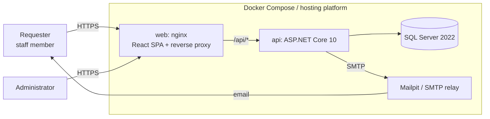
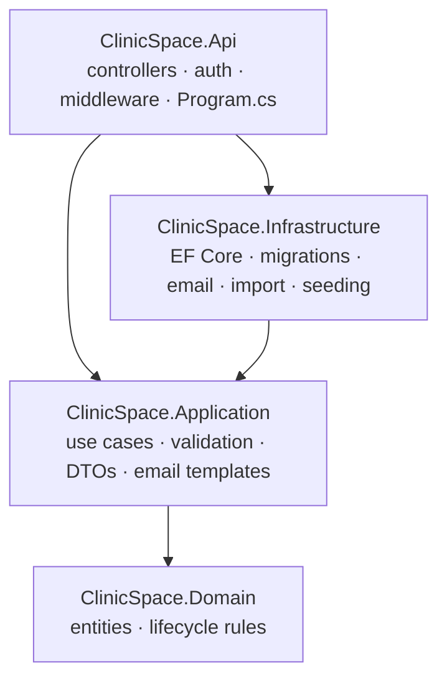
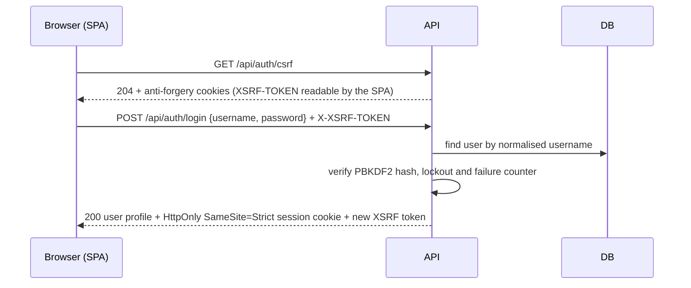
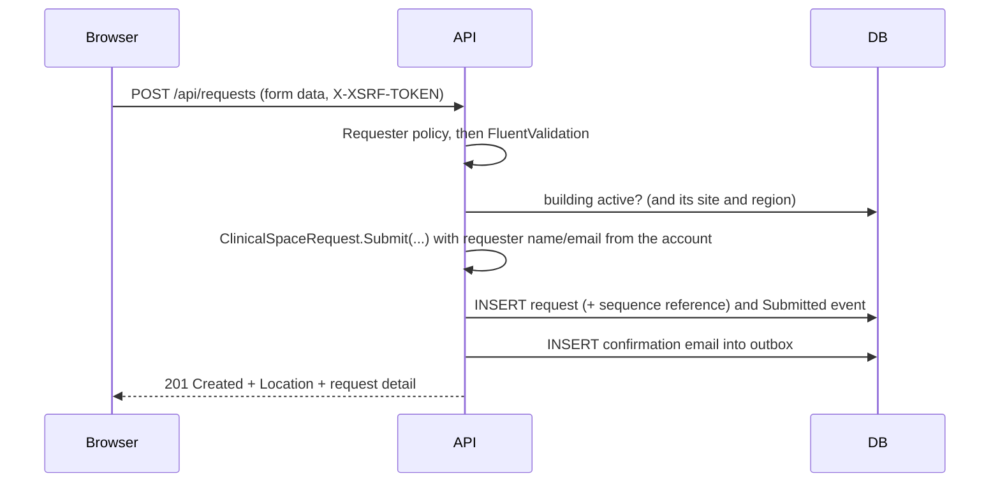

# Architecture

## 1. Context



| Container | Image | Role |
|---|---|---|
| `web` | `nginx:1.27-alpine` (non-root) | Serves the React build, sets the CSP and security headers, proxies `/api` to the API |
| `api` | `mcr.microsoft.com/dotnet/aspnet:10.0` (non-root) | REST API, authentication, business rules, outbox email worker |
| `db` | `mcr.microsoft.com/mssql/server:2022-latest` | Relational data |
| `mail` | `axllent/mailpit` | Catches outgoing email in development and shows it in a web inbox |

## 2. Backend structure (Clean Architecture, kept light)



- **Domain** has no framework dependencies. `ClinicalSpaceRequest.Submit/Accept/Reject` are the only way to change a request's state, and they write the audit event. So the rules ("only Submitted can be decided", "reject needs a reason", "no deciding your own request") hold whichever code path calls them.
- **Application** holds the use cases (`AuthService`, `LocationService`, `RequestService`), the FluentValidation validators and the email templates. It uses `IAppDbContext`, an interface over the EF Core context. EF Core is already a unit of work and repository, so there's no extra repository layer (ADR 0004).
- **Infrastructure** implements persistence (SQL Server), email transports, the outbox dispatcher, the location importer and start-up seeding.
- **Api** is the composition root and the HTTP edge: authentication, authorisation policies, anti-forgery, rate limiting, exception-to-problem-details mapping and security headers.

Dependencies point inwards. Swapping SQL Server, the email provider or the authentication scheme doesn't touch the domain or the use cases.

## 3. Frontend structure

```
src/
  api/          fetch wrapper (CSRF header, problem details → ApiError), typed endpoints, DTO types
  auth/         AuthContext (session state from /api/auth/me), RequireRole route guard
  components/   NHS-style building blocks: Layout, Page, Button, ErrorSummary, form fields, SummaryList, StatusTag…
  features/
    auth/       Sign in
    requests/   Form → Check answers → Confirmation, My requests, request detail, shared request views
    admin/      All requests (filters/sort/paging), review and decision
  lib/          UK date/time helpers (Europe/London), document title
```

- **Server state** lives in TanStack Query (caching, refetch on focus, invalidation after changes).
- **Form state** lives in React Hook Form. Zod gives instant client-side checks that mirror the server rules. The server is always the authority.
- **List filters live in the URL** (`?status=Submitted&search=…`), so back, refresh and shared links keep the same view.
- **Routes are guarded by role.** The guards only shape the UI; the API enforces the same rules.

## 4. Key flows

### Sign in



### Submit a request



### Decide a request

```mermaid
sequenceDiagram
  participant B as Admin browser
  participant API
  participant DB
  participant W as Outbox worker
  participant S as SMTP
  B->>API: POST /api/requests/{id}/decision {decision, notes, version}
  API->>API: Administrator policy, then validation
  API->>DB: load request; compare rowversion with "version"
  API->>API: request.Accept/Reject (domain rules + audit event)
  API->>DB: one transaction: UPDATE request WHERE RowVersion = @original, INSERT event, INSERT email
  alt someone else changed it first
    DB-->>API: 0 rows affected
    API-->>B: 409 Conflict (reload and try again)
  else saved
    API-->>B: 200 updated request
  end
  loop every 5 seconds
    W->>DB: due, unsent emails
    W->>S: send
    W->>DB: mark sent / schedule retry / dead-letter
  end
```

## 5. Cross-cutting concerns

| Concern | Approach |
|---|---|
| Errors | `GlobalExceptionHandler` maps exceptions to RFC 9457 problem details: validation → 400 with field errors, not found → 404, rule or concurrency conflict → 409, CSRF → 400, anything else → 500 with a generic message and a trace ID. Stack traces are never returned. |
| Logging | Structured JSON console logs outside development (ready for Azure Monitor, Splunk or ELK). Every response carries `X-Correlation-ID`, which matches the log scope and the `traceId` in error responses. Personal data is not logged (user IDs only). |
| Health | `/health/live` (process up) and `/health/ready` (database reachable), used by the Docker health checks and suited to load balancer probes. |
| Configuration | `appsettings.json` defaults, overridden per environment by `appsettings.{Environment}.json` and environment variables. Options classes: `Auth`, `Security`, `Requests`, `Notifications`, `Email`, `Seed`, `DataProtection`. |
| Time | Everything is stored as `datetimeoffset` in UTC. `TimeProvider` is injected, so tests control the clock. All display uses Europe/London. |
| Data protection keys | Persisted to a volume (`DataProtection__KeysDirectory`), so restarts don't sign users out. Production: Azure Blob Storage + Key Vault. |

## 6. Scaling notes

- The API is stateless apart from data-protection keys, which must be shared across instances (see above).
- The outbox worker assumes a single instance. To run several, claim rows with `UPDATE … OUTPUT … WITH (UPDLOCK, READPAST)` or move to a queue (Azure Service Bus).
- The rate limiter is in memory per instance. For a cluster, use a distributed limiter or apply it at the gateway (Azure Front Door / API Management).
