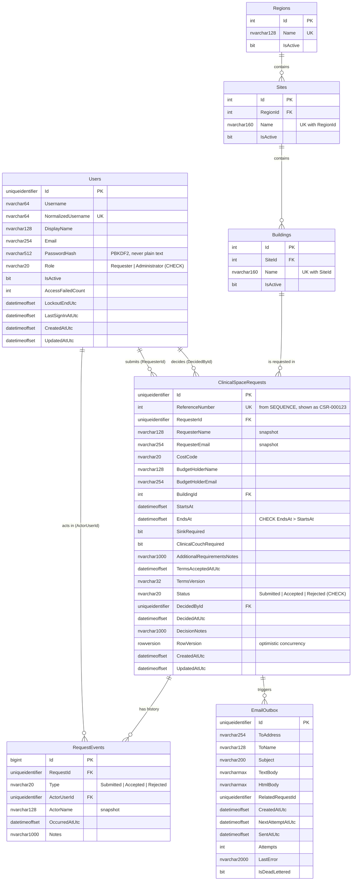

# Data model

## Design notes

| Choice | Reason |
|---|---|
| **Location hierarchy as three tables** (Region → Site → Building) with `IsActive` flags | Matches the dependent drop-downs and the supplied data. Deactivating a building hides it from new requests while keeping old requests valid. Rows are never deleted. |
| **Unique names within the parent** (`Sites(RegionId, Name)`, `Buildings(SiteId, Name)`) | Stops duplicate imports, and lets the same building name exist on different sites. |
| **GUID primary key + sequential reference number** | GUIDs don't reveal how many requests exist and can't be guessed in URLs. The `RequestReferenceNumbers` sequence gives people a short, readable reference (`CSR-000123`) for phone calls and emails. |
| **Requester name/email snapshot** on the request | The record and its emails stay accurate after a name or email change. The audit trail shows who it was *at the time*. |
| **Status stored as text with a CHECK constraint** | Readable in SQL and reports. The database rejects invalid values even if the application has a bug. |
| **`CK_Requests_Decision`** | Enforces the rule that a submitted request has no decider and a decided request always has one. |
| **`RowVersion`** | SQL Server updates it automatically on every change. EF Core adds it to the `WHERE` clause, so a stale update affects 0 rows and becomes a 409. |
| **`RequestEvents` append-only history** | A simple, queryable audit trail ("who accepted this, when, and why?"). Shown to users as a timeline. |
| **`EmailOutbox`** | Transactional outbox: the email is committed atomically with the change that caused it. A filtered index (`WHERE SentAtUtc IS NULL AND IsDeadLettered = 0`) keeps the worker's polling query cheap. |
| **`datetimeoffset`** everywhere | Unambiguous instants. Display in Europe/London is a presentation concern. |
| **`ON DELETE RESTRICT`** on all foreign keys except request → events | Nothing can be removed in a way that orphans history. |

## Indexes

| Index | Serves |
|---|---|
| `Users(NormalizedUsername)` unique | Sign-in look-up |
| `ClinicalSpaceRequests(RequesterId, CreatedAtUtc)` | My Requests |
| `ClinicalSpaceRequests(Status, CreatedAtUtc)` | Admin queue and filters |
| `ClinicalSpaceRequests(BuildingId, StartsAt, EndsAt)` | Overlap (clash) check |
| `ClinicalSpaceRequests(ReferenceNumber)` unique | Search by reference |
| `RequestEvents(RequestId, OccurredAtUtc)` | Timeline |
| `EmailOutbox(NextAttemptAtUtc)` filtered | Outbox polling |

## Migrations

EF Core migrations are in `backend/src/ClinicSpace.Infrastructure/Persistence/Migrations`. See the README, section 5, for applying them, scripting them for DBA review, and adding new ones.
